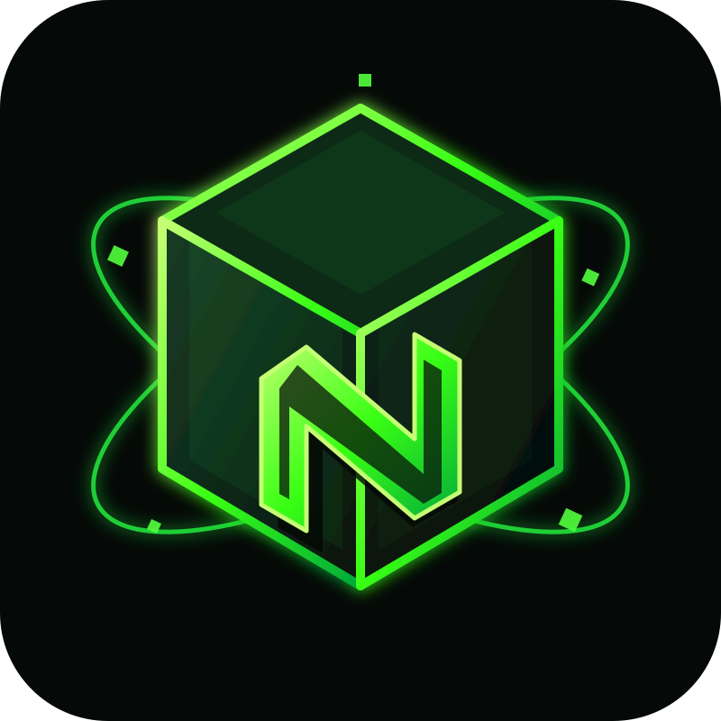

  

<h1 align="center">Nexus — Minecraft PE</h1>

**Español:** Nexus es un motor experimental para cargar y organizar mods JavaScript en Minecraft Pocket Edition 1.0.9 mediante Toolbox 3.2.29 y Rhino/ModPE. Nació para explorar una forma más ligera de ampliar versiones antiguas de Minecraft PE y dar a los creadores una API común para sus mods, sin depender de las exigencias de las versiones modernas.

**English:** Nexus is an experimental engine for loading and organizing JavaScript mods in Minecraft Pocket Edition 1.0.9 through Toolbox 3.2.29 and Rhino/ModPE. It was created to explore a lightweight way to extend older Minecraft PE versions and give mod creators a shared API, without relying on the demands of modern versions.

> **Estado / Status:** Nexus V0.2.1 es inestable y debe considerarse una versión de pruebas. Actualmente se está trabajando en V0.3.0; todavía no debe considerarse una versión estable ni una publicación final.
>
> **Nexus V0.2.1 is unstable and should be treated as a testing build. V0.3.0 is currently in development and is not yet a stable or final release.**

Nexus no es Forge oficial y no promete compatibilidad con versiones modernas de Minecraft. La compatibilidad real debe comprobarse en el entorno objetivo.

Nexus is not official Forge and does not promise compatibility with modern Minecraft versions. Actual compatibility must be tested in the target environment.

## Descargas / Downloads

Todas las descargas oficiales se publicarán únicamente en [Lanzamientos / Releases](https://github.com/Narutojataque12/Nexus-Minecraft-PE/releases).

All official downloads will be published only on [Releases](https://github.com/Narutojataque12/Nexus-Minecraft-PE/releases).

## Guías / Guides

Consulta la [guía bilingüe para crear mods](docs/INSTRUCCIONES_CREAR_MODS.md) para conocer las convenciones y la API disponible.

See the [bilingual mod-creation guide](docs/INSTRUCCIONES_CREAR_MODS.md) for the conventions and available API.

## Créditos / Credits

- **Sebastián C.** — creador del proyecto Nexus / Nexus project creator.
- **Mojang** — Minecraft.
- **Toolbox** — sus creadores y mantenedores / its creators and maintainers.
- **Rhino** — Mozilla y sus colaboradores / Mozilla and contributors.

## Licencia / License

Consulta [LICENSE](LICENSE). Es una licencia personalizada no comercial con atribución; no está aprobada por OSI.

See [LICENSE](LICENSE). It is a custom non-commercial attribution license and is not OSI-approved.
